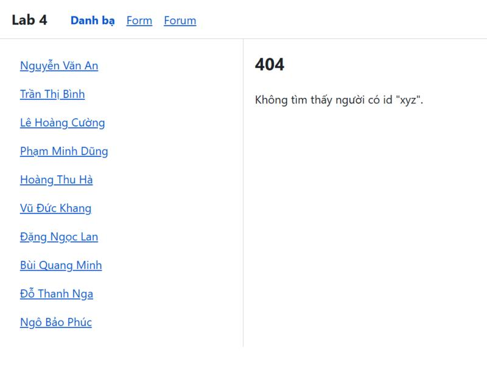
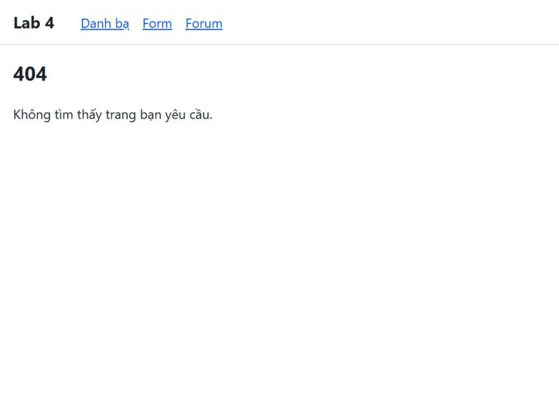
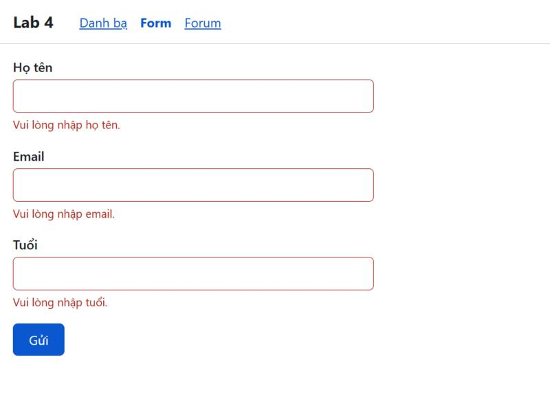
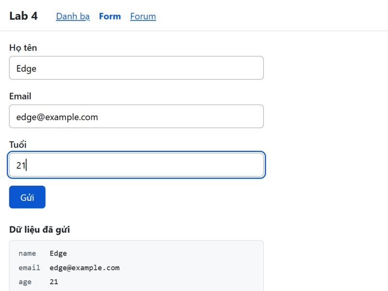
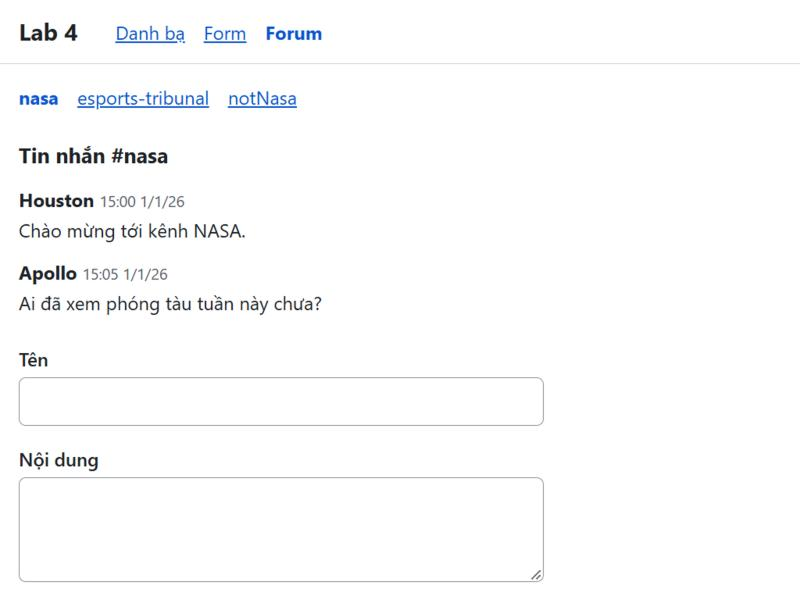

# Checkpoint trình duyệt — Sprint 1 & 2

**Ngày:** 16/11/2026 · **Trình duyệt:** Chromium 156.0.8078.75 (browser pane của Claude desktop, trên máy Windows của người làm lab) · client `npm run dev` (Vite) + server `npm run dev` (Express).
Mọi kết quả dưới đây là quan sát thật; số liệu đo bằng DOM/`getComputedStyle` ngay trên trang.

## Sprint 1 — Router v7, Master–Detail, Lazy

| # | Checkpoint | Kết quả | Bằng chứng |
|---|---|---|---|
| 1 | Reload trực tiếp `/people/2` | ✅ Render detail "Trần Thị Bình" trong `<dl>`; đúng 1 `<main>`; NavLink active: `/people` và `/people/2` |  |
| 2 | Id sai `/people/xyz` | ✅ 404 `role="alert"`: *Không tìm thấy người có id "xyz".* — sidebar vẫn còn 10 link |  |
| 3 | Path lạ `/abc` | ✅ 404 toàn trang: *Không tìm thấy trang bạn yêu cầu.* — không có sidebar |  |
| 4 | CSS Grid desktop (1024px) | ✅ `.people-layout` `grid-template-columns: 341.333px 682.667px` (= 1fr : 2fr) | ảnh #1 |
| 5 | Responsive 375px (< 640px) | ✅ `grid-template-columns: 375.333px` (1 cột); `scrollWidth` = 375 → không tràn ngang |  |
| 6 | Lazy chunk | ✅ Network tải riêng `src/people/PersonDetail.jsx` khi vào route detail (dev). Bản build: chạy `npm run build` để thấy file `dist/assets/PersonDetail-*.js` riêng | log Network |
| 7 | Console | ✅ Sau khi tải lại trang: 0 warning, 0 error (chỉ log `[vite] connected` và gợi ý React DevTools) | log Console |

### Phát hiện khi kiểm chứng — thiếu Error Boundary cho chunk lazy
Khi dev server client bị tắt đúng lúc trang chuyển sang `/people/2`, import động thất bại:
```
Uncaught TypeError: Failed to fetch dynamically imported module: http://localhost:5173/src/people/PersonDetail.jsx
An error occurred in one of your React components. Consider adding an error boundary to your tree...
```
Kết quả: `#root` rỗng — **toàn bộ app trắng trang**, không chỉ vùng detail. Nguyên nhân: `<Suspense>` chỉ xử lý trạng thái *đang tải*, không bắt lỗi *tải thất bại*; cần `ErrorBoundary` bọc quanh. (Ghi nhận ở `AI_FAILURE_AUDIT.md`.)

## Sprint 2 — Context Form Engine

| # | Checkpoint | Kết quả | Bằng chứng |
|---|---|---|---|
| 1 | Submit form trống | ✅ 3 lỗi `role="alert"` (họ tên, email, tuổi), 3 input `aria-invalid="true"`, không hiện inspector |  |
| 2 | Submit hợp lệ (Edge / edge@example.com / 21) | ✅ Hết lỗi, hiện "Dữ liệu đã gửi" dạng `<dl>` |  |
| 3 | 0 `useEffect` trong `client/src/form/` | ✅ `grep useEffect client/src/form` → không có kết quả | lệnh |

## Sprint 3 — Forum
Chi tiết ở [`verification.md`](verification.md). Ảnh kênh `#nasa`: 
